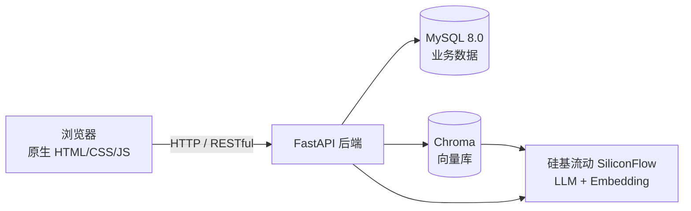

# 智学助手（StudyMate）

> 基于 LangChain 的课程知识库问答与出题智能体，打通「上传资料 → 智能问答 → 自动出题 → 错题本 → 复习计划」的完整学习闭环。

## 项目简介

智学助手是一款面向个人学习场景的轻量化智能学习工具。用户上传课程资料后，系统自动完成文档解析、切分与向量化，构建课程专属知识库，并提供五大核心能力：

1. **上传文档（F1）**：解析 PDF / Word / Markdown / TXT，构建向量知识库；
2. **智能问答（F2）**：基于 RAG 检索增强生成，回答可溯源；
3. **自动出题（F3）**：按题型、难度、数量生成题目，客观题自动判分、简答题 AI 评分；
4. **错题本（F4）**：答错自动沉淀，支持标记掌握；
5. **复习计划（F5）**：基于错题生成 7 天复习计划。

## 技术栈

| 层次 | 技术 |
| --- | --- |
| 语言 | Python 3.11 |
| Web 框架 | FastAPI + Uvicorn |
| AI 编排 | LangChain |
| 文档解析 | pypdf（PDF）、python-docx（Word）、原生文本（MD/TXT） |
| 业务数据库 | MySQL 8.0 |
| 向量数据库 | Chroma（本地持久化） |
| LLM / Embedding | 硅基流动（SiliconFlow）OpenAI 兼容接口：`deepseek-ai/DeepSeek-V4-Flash` + `BAAI/bge-m3` |
| 前端 | 原生 HTML + CSS + JavaScript |
| 部署 | Docker + docker-compose |

## 架构设计



- **MySQL** 存储课程、文档、题目、错题、复习计划等结构化数据；
- **Chroma** 存储文档向量（每个课程一个独立 collection）；
- **硅基流动** 提供 LLM（生成）与 Embedding（向量化）能力。

## 目录结构

```
langchain_agent/
├── app/
│   ├── main.py              # FastAPI 应用入口（挂载路由、静态目录、lifespan）
│   ├── config.py            # pydantic-settings 配置（读取 .env）
│   ├── core/                # 核心基础
│   │   ├── response.py      # ApiResponse 统一返回
│   │   └── exceptions.py    # 全局异常处理
│   ├── db/                  # 数据库连接
│   │   ├── base.py          # SQLAlchemy ORM 基类
│   │   ├── mysql.py         # MySQL 连接与会话
│   │   └── chroma.py        # Chroma 向量库工厂 + Embedding
│   ├── models/              # SQLAlchemy ORM 模型
│   ├── schemas/             # Pydantic v2 请求/响应 Schema
│   ├── routers/             # API 路由层（控制层）
│   ├── services/            # 业务逻辑层
│   └── prompts/             # Prompt 模板
├── static/                  # 前端静态资源（HTML/CSS/JS）
├── tests/                   # 测试脚本与测试数据
│   ├── test_*.py            # 功能验证脚本（Chroma/入库/出题/切分）
│   └── data/                # 测试数据文件（.md）
├── docs/                    # PRD / SPEC / AGENTS 规范文档
├── .env                     # 环境变量（不提交）
├── .env.example             # 环境变量样例
├── requirements.txt         # 生产依赖（已精简）
├── requirements-dev.txt     # 测试依赖（pytest）
├── Dockerfile               # 生产镜像
├── .dockerignore
├── deploy.py                # 一键部署脚本（上传 + 构建 + 启动 + 自检）
├── pytest.ini               # pytest 配置
├── docker-compose.yml       # MySQL + 应用容器编排
└── README.md
```

## 快速开始

### 1. 环境要求

- Python 3.11+
- Docker（用于运行 MySQL）

### 2. 配置 .env

复制 `.env.example` 为 `.env`，并填写密钥：

```bash
# Linux / macOS
cp .env.example .env

# Windows（cmd）
copy .env.example .env
```

编辑 `.env`，至少填写：

```ini
SILICONFLOW_API_KEY=sk-你的密钥
```

其余配置（模型、MySQL、Chroma）已有合理默认值，可按需调整。

### 3. 启动 MySQL

```bash
docker-compose up -d
```

### 4. 安装依赖并启动后端

```bash
pip install -r requirements.txt
uvicorn app.main:app --reload --port 8000
```

### 5. 访问

| 地址 | 说明 |
| --- | --- |
| http://127.0.0.1:8000 | 前端页面 |
| http://127.0.0.1:8000/docs | Swagger API 文档 |
| http://127.0.0.1:8000/api/health | 健康检查（MySQL / Chroma 连通性） |

### 6. 运行测试

```bash
# 测试依赖（生产镜像不装）
pip install -r requirements-dev.txt

# 方式一：pytest（验证 import 与测试收集）
.venv\Scripts\python.exe -m pytest -v

# 方式二：直接运行测试脚本（功能验证，测试数据在 tests/data/）
.venv\Scripts\python.exe tests\test_split_markdown.py    # 纯本地，验证 Markdown 两层切分
.venv\Scripts\python.exe tests\test_chroma.py            # 需要 SILICONFLOW_API_KEY
.venv\Scripts\python.exe tests\test_document_ingest.py   # 需要 API Key + MySQL
.venv\Scripts\python.exe tests\test_quiz.py              # 需要 API Key + MySQL + 已有文档课程
```

## 核心功能

### F1 上传文档

- **前端**：左侧「新建课程」创建课程 → 选中课程 → 「文档管理」Tab → 点「上传文档」选择文件。
- **支持格式**：PDF、Word（.docx）、Markdown、TXT（`.doc` 需另存为 `.docx`）。
- **Markdown 特化切分**：按 `#/##/###` 标题两层切分，保留章节 metadata（h1/h2/h3），提升检索命中率。
- **删除文档**：文档列表每条右侧「×」，确认后按 `metadata.document_id` 同步删除该文档在 Chroma 中的向量与 MySQL 记录（不影响同课程其他文档）。
- **相关 API**：`POST /api/courses/{id}/documents`、`GET /api/courses/{id}/documents`、`DELETE /api/documents/{document_id}`。

### F2 智能问答

- **前端**：「智能问答」Tab，输入问题回车发送，展示 AI 回答 + 引用来源卡片。
- **实现**：查询加 bge-m3 前缀 → Chroma 相似度检索（top_k）→ 拼接上下文 → LLM 生成，回答可溯源、不编造。
- **相关 API**：`POST /api/courses/{id}/chat`。

### F3 自动出题

- **前端**：「自动出题」Tab，选择题型（单选/多选/判断/简答）、难度、数量 → 生成题目卡片。
- **作答**：客观题点击选项 → 「提交答案」自动判分；简答题输入答案 → AI 语义打分（含评分与理由）。
- **相关 API**：`POST /api/courses/{id}/quizzes/generate`、`POST /api/questions/{id}/submit`。

### F4 错题本

- **前端**：「错题本」Tab，展示题干、你的答案、正确答案、解析。
- **交互**：答错自动入错题本；「标记已掌握」后从列表移除。
- **相关 API**：`GET /api/courses/{id}/mistakes`、`PATCH /api/mistakes/{id}`、`DELETE /api/mistakes/{id}`。

### F5 复习计划

- **前端**：「复习计划」Tab，点「生成复习计划」→ 按日期分组展示复习条目，勾选完成。
- **实现**：读取未掌握错题 → LLM 生成 7 天计划（只返回第 N 天，日期由 Python 计算）→ 写入 `review_plans` / `review_items`。
- **相关 API**：`POST /api/courses/{id}/review-plans`、`GET /api/courses/{id}/review-plans`、`GET /api/review-plans/{id}`、`PATCH /api/review-items/{id}`。

## 依赖精简说明

原 `requirements.txt` 是「学习环境全量清单」（jupyter、torch、transformers、unstructured、milvus、psycopg、langgraph、MCP 等），体积约 2–3 GB，与项目实际代码无关。现已按真实 import 收敛为 **14 个直接依赖**：

- 文档解析从 `unstructured`（依赖 torch/onnx/opencv）换成 `pypdf` + `python-docx`，`app/services/document_service.py` 同步改写；Markdown 仍走「标题两层切分」。
- 补齐了原本缺失的 `python-multipart`（FastAPI 解析 `UploadFile` 必需）。
- `pytest` 移到 `requirements-dev.txt`，生产镜像不再安装。
- 格式支持相应调整：`.pdf / .docx / .md / .txt`；`.doc` 需另存为 `.docx`。

## 服务器部署（Docker）

生产环境用 `docker-compose.yml` 同时管理 MySQL 与应用；应用镜像由 `Dockerfile` 构建，`deploy.py` 负责上传、构建、启动与自检。

线上地址：**<https://xingkongzcj.cloud>**（80 自动跳转 https；`http://47.109.147.248:8000` 作为兜底直连）

```bash
# 本地执行（需要 paramiko；凭据只走环境变量，不落盘）
export SM_SSH_PASSWORD='服务器 root 密码'
export SM_API_KEY='sk-...'
python deploy.py probe       # 探测环境（系统、Docker、镜像源、端口）
python deploy.py bootstrap   # 首次：装 Docker、配镜像加速、补 swap、拉基础镜像
python deploy.py upload      # 上传代码并写 .env（权限 600）
python deploy.py build       # 构建镜像
python deploy.py up          # 启动并等待 /api/health 就绪
python deploy.py status      # 容器状态 + 内存/CPU 占用
```

服务器上的布局：

| 路径 / 资源 | 说明 |
| --- | --- |
| `/opt/studymate` | 部署目录（代码、`.env`、compose 文件） |
| 卷 `mysql_data` | MySQL 数据 |
| 卷 `chroma_data` | Chroma 向量库（容器内 `/data/chroma`） |

- 应用容器以非 root 用户（uid 10001）运行；MySQL 仅绑定 `127.0.0.1:3307`，公网不可达。
- 需在云厂商安全组放行 **8000** 端口。
- 国内机器 Docker Hub 不可达，`bootstrap` 会写入 `/etc/docker/daemon.json` 使用公共镜像站。
- 时区固定 `Asia/Shanghai`（复习计划按本地日期生成，容器默认 UTC 会错位 8 小时）。

### 校园网 / 运营商封 SSH

部分校园网和运营商会按**协议特征**拦截 SSH（TCP 能握手成功，但读不到 `SSH-2.0` 横幅），这种情况换端口没有用。解决办法是在服务器上用 `stunnel` 把 SSH 包进 TLS：

```ini
# /etc/stunnel/ssh-tls.conf
foreground = yes
[ssh-tls]
accept  = 443
connect = 127.0.0.1:22
cert    = /etc/stunnel/ssh-tls.crt
key     = /etc/stunnel/ssh-tls.key
```

配合独立的 `ssh-tls.service`（`ExecStart=/usr/bin/stunnel4 /etc/stunnel/ssh-tls.conf`）常驻，并在安全组放行 443。客户端在 `~/.ssh/config` 里用 `ProxyCommand` 先建 TLS 隧道：

```
Host studymate
    HostName <服务器 IP>
    User root
    ProxyCommand openssl s_client -quiet -verify_quiet -connect <服务器 IP>:443 -servername <服务器 IP>
```

`deploy.py` 会先探测 22 端口能否真的跑 SSH，不能时自动改走 TLS 443；也可用 `SM_SSH_TLS=1` 强制。

> 注意：443 被 SSH-TLS 占用后，同一台机器就不能直接放 HTTPS 站点了（需要的话改用 8443 或做 SNI 分流）。

## 项目文档

| 文档 | 说明 |
| --- | --- |
| [docs/PRD.md](docs/PRD.md) | 产品需求文档 |
| [docs/SPEC.md](docs/SPEC.md) | 技术规范文档 |
| [AGENTS.md](AGENTS.md) | AI 编程规范 |
